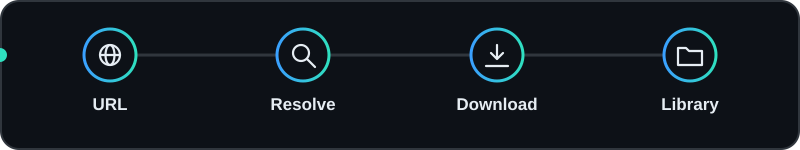

<h1 align="center">T.O.N.S Asset Retriever</h1>

<b>Media Retrieval Utility for Local Environments</b>
 
<i>An open-source network utility for parsing and downloading public media assets via URLs.</i>

  

  

<a href="#how-it-works">How it works</a> &nbsp;·&nbsp; <a href="#capabilities">Capabilities</a> &nbsp;·&nbsp; <a href="#requirements">Requirements</a> &nbsp;·&nbsp; <a href="#usage">Usage</a> &nbsp;·&nbsp; <a href="#screenshots">Screenshots</a>

  

 

> **Overview:** T.O.N.S Asset Retriever is a dedicated utility designed to resolve user-provided URLs and securely download corresponding public media assets to be used offline in local desktop environments.

## How it works

## Capabilities

<table>
<tr>
<td width="50%" valign="top"> <b>URL Resolution</b> Parses provided web links to locate and retrieve specific media files.</td>
<td width="50%" valign="top"> <b>Direct Extraction</b> Downloads raw asset files and packages them directly into accessible local directories.</td>
</tr>
<tr>
<td width="50%" valign="top"> <b>Minimalist Interface</b> A streamlined graphical user interface focused strictly on network input/output operations.</td>
<td width="50%" valign="top"> <b>Local Library Management</b> Facilitates the creation of an offline repository for desktop media files.</td>
</tr>
</table>

## Requirements

| Specification | Requirement |
| :--- | :--- |
| **Operating System** | Windows 10 / Windows 11 |
| **Architecture** | x64 |
| **Network** | Active internet connection for URL resolution and downloading |
| **Storage** | Sufficient local space for retrieved media files |

## Usage

1. Go to the **[Releases](https://github.com/Project-Tons/T.O.N.S_Workshop/releases/latest)** page and download the latest executable binary.
2. Extract the files to a directory of your choice.
3. Launch the application.
4. Input the target media URL into the designated field to initiate the retrieval process.

## Screenshots

 <b>Main Interface</b>

 

<table>
<tr><td width="50%" align="center"> <b>Downloading State</b></td><td width="50%" align="center"> <b>Finished Output (1)</b></td></tr>
<tr><td width="50%" align="center"> <b>Finished Output (2)</b></td><td width="50%" align="center"> <b>Finished Output (3)</b></td></tr>
</table>

 

T.O.N.S Asset Retriever &nbsp;·&nbsp; Project-Tons

