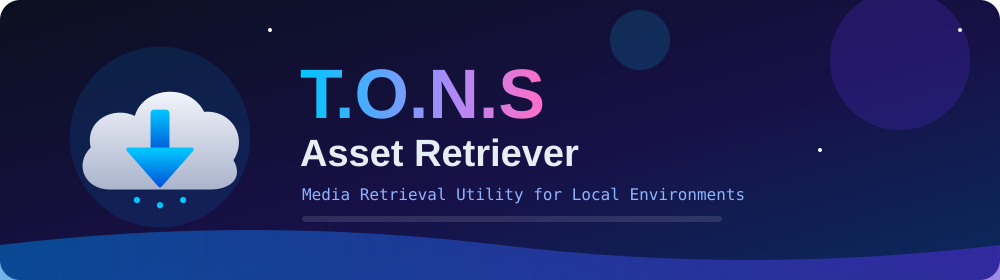

      

 

 

<h2 align="center"> Overview</h2>

<b>T.O.N.S Asset Retriever</b> is a dedicated utility that resolves user-provided URLs 
and securely downloads the matching public media assets for offline use in local desktop environments.

<h2 align="center"> Technical Capabilities</h2>

<table align="center">
<tr>
<td align="center" width="25%"><h3></h3><b>URL Resolution</b> Parses provided web links to locate and retrieve specific media files.</td>
<td align="center" width="25%"><h3></h3><b>Direct Extraction</b> Downloads raw asset files and packages them directly into accessible local directories.</td>
<td align="center" width="25%"><h3></h3><b>Minimalist Interface</b> A streamlined graphical interface focused strictly on network input/output operations.</td>
<td align="center" width="25%"><h3></h3><b>Local Library</b> Facilitates the creation of an offline repository for desktop media files.</td>
</tr>
</table>

<h2 align="center"> System Requirements</h2>

<table align="center">
<tr><th align="left">Specification</th><th align="left">Requirement</th></tr>
<tr><td><b>Operating System</b></td><td>Windows 10 / Windows 11</td></tr>
<tr><td><b>Architecture</b></td><td>x64</td></tr>
<tr><td><b>Network</b></td><td>Active internet connection for URL resolution and downloading</td></tr>
<tr><td><b>Storage</b></td><td>Sufficient local space for retrieved media files</td></tr>
</table>

<h2 align="center"> Quick Start</h2>

<table align="center">
<tr>
<td align="center" width="25%"><h1>01</h1><b>Download</b> Go to the <a href="https://github.com/Project-Tons/T.O.N.S_Workshop/releases/latest">Releases</a> page and download the latest executable binary.</td>
<td align="center" width="25%"><h1>02</h1><b>Extract</b> Extract the files to a directory of your choice.</td>
<td align="center" width="25%"><h1>03</h1><b>Launch</b> Launch the application.</td>
<td align="center" width="25%"><h1>04</h1><b>Retrieve</b> Input the target media URL into the designated field to start the retrieval process.</td>
</tr>
</table>

<h2 align="center"> Application Screenshots</h2>

 <b>1. Main Interface</b>
  

 <b>2. Downloading State</b>
  

 <b>3. Finished Output</b>
  

 <b>4. Finished Output</b>
  

 <b>5. Finished Output</b>
  

